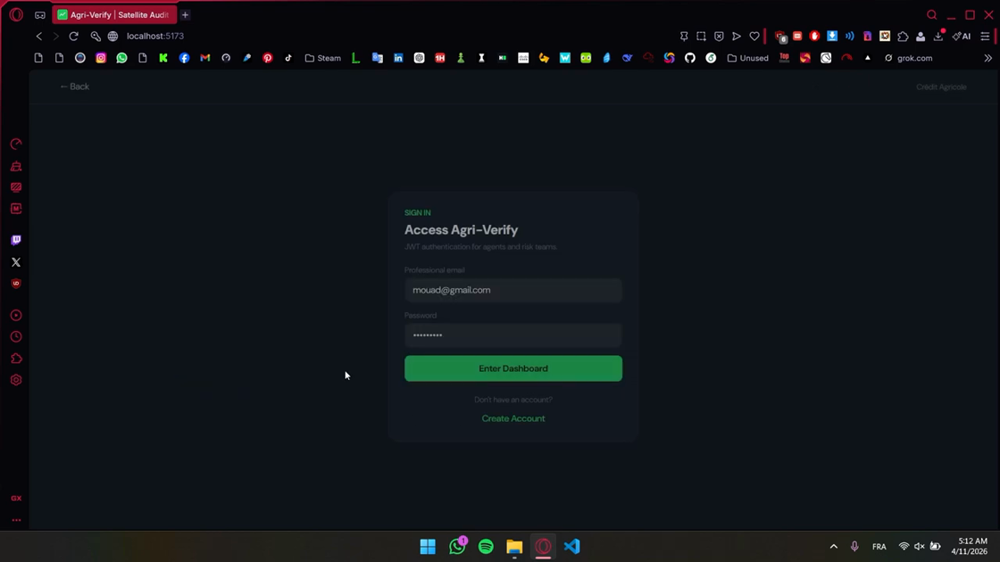
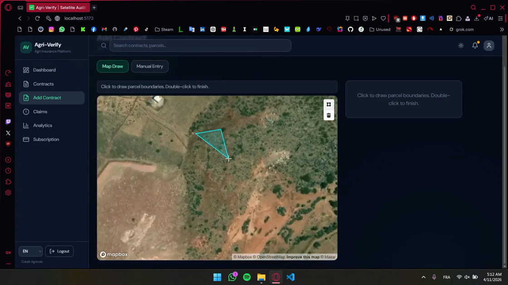
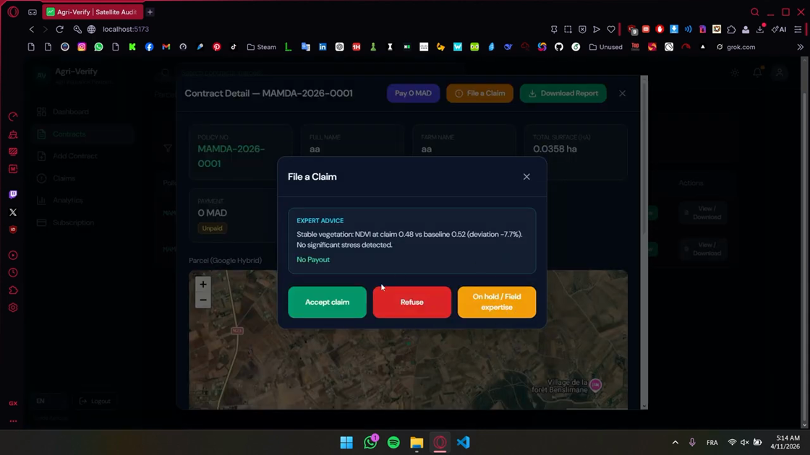
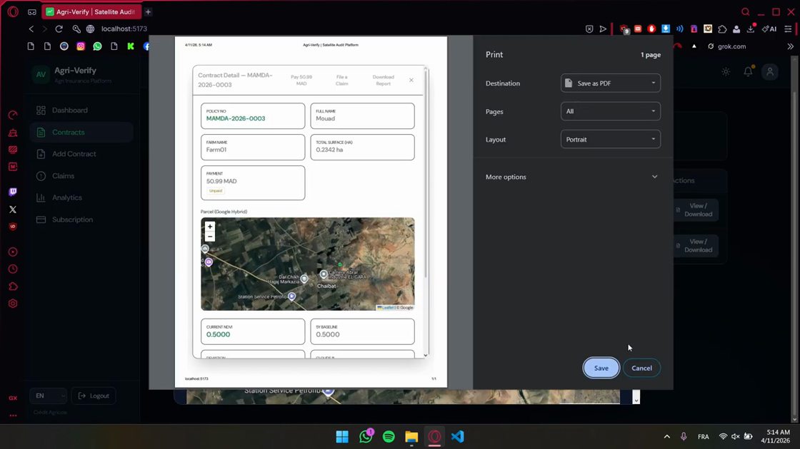
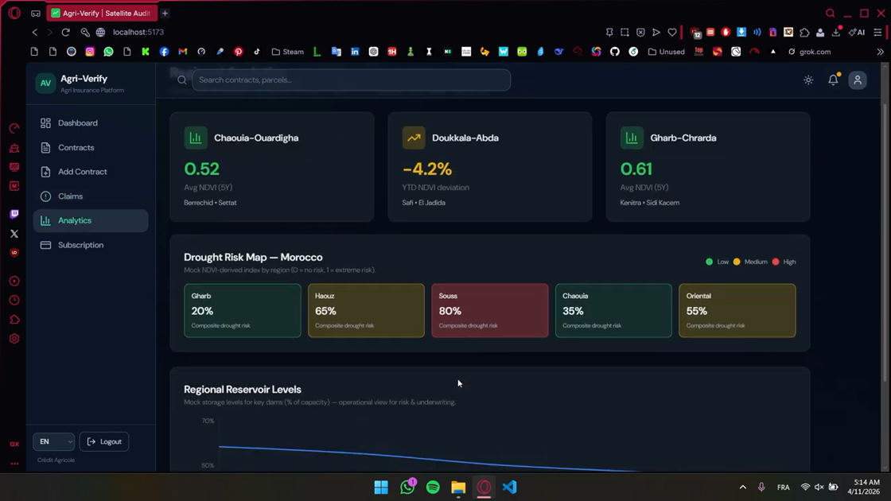

<div align="center">

# 🌾 Agri-Verify

### Satellite-assisted agricultural insurance monitoring & claims management

**A product demo for agricultural parcel mapping, contract workflows, claim review, and regional analytics.**

[](#project-status) [](#overview) [](#overview)

**[▶ Watch the 33-second demo in your browser](https://raw.githack.com/houssam-ops/agri-verify/main/watch.html)** · **[Features](#features)** · **[Screenshots](#screenshots)** · **[Documentation](docs/PROJECT_OVERVIEW.md)**

</div>



## Overview

**Agri-Verify** is a web interface for an agricultural insurance workflow supported by satellite imagery. The recorded demonstration shows parcel selection on a map, creation of agricultural contracts, generation of a contract PDF, a claim decision interface, a regional analytics dashboard, and a subscription checkout flow.

> **Project status:** This repository currently contains a **video demo, screenshots, and project documentation**. The implementation/source code has not yet been provided and is **not included**. Screens and displayed values are demonstration examples, not independently verified production results.

## Features

| Area | Demonstrated workflow |
| --- | --- |
| 📊 Dashboard | Portfolio indicators, active contracts, pending claims, and aggregate metrics |
| 🗺️ Parcel mapping | Satellite map, parcel boundary drawing, and area selection |
| 📑 Contracts | Form-based contract registration and contract summary |
| 📄 Reporting | Contract details and a printable PDF report preview |
| 🛡️ Claims | Claim submission/review interface with response actions |
| 📈 Regional analytics | Regional vegetation and drought-risk indicators displayed in a dashboard |
| 💳 Subscription | A paid-plan checkout screen appears in the demo |

**Note:** The video demonstrates the UI workflows; it does not establish that satellite assessments, payments, or automated claim decisions are deployed in production.

## Screenshots

| Parcel mapping | Claim review |
| --- | --- |
|  |  |

| Contract reporting | Regional analytics |
| --- | --- |
|  |  |

## Video walkthrough

[](https://raw.githack.com/houssam-ops/agri-verify/main/watch.html)

### [▶ Watch the full video online (33 seconds)](https://raw.githack.com/houssam-ops/agri-verify/main/watch.html)

**[⬇ Download MP4 (optional)](https://raw.githubusercontent.com/houssam-ops/agri-verify/main/assets/agri-verify-demo.mp4)**

Click **Watch the full video online** or the preview above to open a dedicated HTML5 player with video controls — no download required. The player is hosted through [raw.githack.com](https://raw.githack.com/), which serves this repository's `watch.html` and the MP4 with browser-compatible content types. Video playback depends on browser support and availability of that third-party proxy. The video file remains in this repository at `assets/agri-verify-demo.mp4` (33 seconds, H.264/AAC).

The recording demonstrates the navigation from the dashboard to parcel mapping, contract registration, report preview, claim processing, analytics, and a subscription interface.

## Publish this repository

On Ubuntu, install the GitHub CLI, authenticate with `gh auth login`, and run `bash publish-to-github.sh`. Full instructions: [DEPLOY_GITHUB.md](DEPLOY_GITHUB.md).

## Repository structure

```text
agri-verify/
├── .github/
│   └── ISSUE_TEMPLATE/
├── assets/
│   ├── agri-verify-demo.mp4
│   └── *.png
├── docs/
│   ├── PROJECT_OVERVIEW.md
│   └── ARCHITECTURE.md
├── .gitignore
├── .gitattributes
├── DEPLOY_GITHUB.md
├── watch.html                # Browser video player
├── publish-to-github.sh
├── CONTRIBUTING.md
├── SECURITY.md
└── README.md
```

## Technology stack

The original source code and package manifests were **not supplied**, so the frontend/backend, mapping API, satellite processing methods, database, and payment integration **cannot be verified** from the recording. Add actual implementation details here once the code is published; do not treat visible branding as proof of an integration.

## Run locally

The project source code is not included in this initial demo repository. Once source files are added, document installation, environment variables (with no secrets), database setup, and startup commands in this section.

## Roadmap

- [x] UI demonstration and project overview
- [x] Screenshots and video walkthrough
- [ ] Publish frontend and backend source files
- [ ] Document stack, configuration, and local setup
- [ ] Add tests and CI checks
- [ ] Document geospatial / satellite data sources and validation approach
- [ ] Clarify production readiness and security posture

## Author

**Houssam ZOUHEIR**  
[GitHub](https://github.com/houssam-ops) · [LinkedIn](https://www.linkedin.com/in/houssam-zouheir/) · [Portfolio](https://houssam-zouheir-portfolio.vercel.app/)

## License

No open-source license has been selected. All rights are reserved by default unless the author adds an explicit license.
